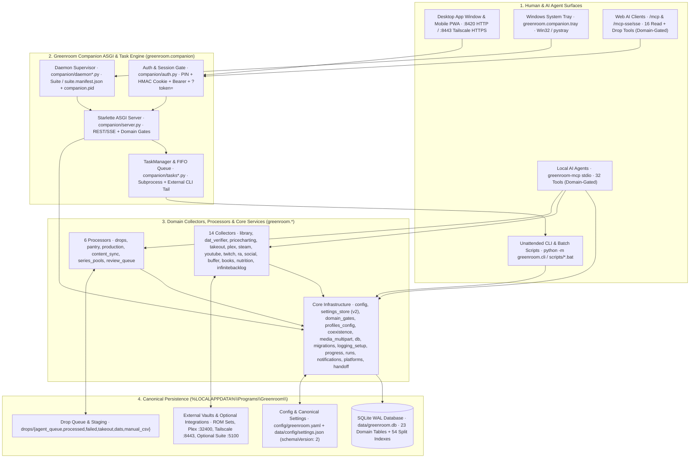
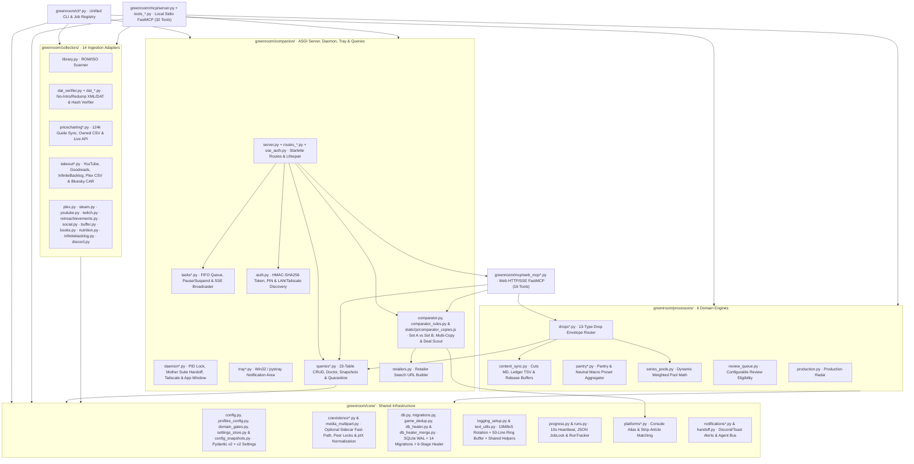

# Greenroom — Architecture & Engineering Manual

> [!IMPORTANT]
> **Manual Authority (`v0.3.0`):** This document is the engineering blueprint for **Greenroom** (`greenroom/__init__.py` `__version__ = "0.3.0"`, `Foundation v0.5.2`, `MPL-2.0`). Every module boundary, SQLite table, domain gate, file contract, and failure mode below is verified directly against the shipping `Dev/` source tree.

---

## 1. System Context & Runtime Model

**Greenroom** is a modular, local-first Python 3.11+ personal data warehouse, scheduled task runner, dual Model Context Protocol (MCP) server, and progressive web application (PWA) Companion hub. It replaces brittle cloud spreadsheets with a single deterministic SQLite WAL database (`data/greenroom.db`), toggleable feature domains (`Catalog`, `Kitchen`, and `Studio`), a background Windows Notification Area (`pystray` / Win32) daemon serving `http://0.0.0.0:8420` (and Tailscale Serve HTTPS `:8443`), a local stdio MCP server (`greenroom-mcp`), and a read-only + drop-builder HTTP/SSE MCP server (`greenroom-web-mcp`).

### Runtime Process Topology
1. **Always-On Companion Daemon (`greenroom.companion.daemon` + `greenroom.companion.server`):**
   - Runs as a detached background `pythonw.exe -m greenroom.cli companion serve` process bound to `0.0.0.0:8420` (or custom `--bind` / `--port` overrides during isolated runs; `--automation-port` fails closed with `ExitCode = 2` in Release builds unless test automation is enabled).
   - Supports standalone installation (`%LOCALAPPDATA%\Programs\Greenroom\`) or optional umbrella supervision via `suite.manifest.json` (`schemaVersion: 2`, `sdkVersion: "0.5.2"`, `--managed-by-suite`, reverse-proxied under `/app/greenroom/`), unless `data/companion.stopped` is present from an explicit shutdown.
   - Hosts the Deep Slate Dark / Light single-page Companion UI (`./` relative paths supporting both `/` and `/app/greenroom/`, `static/js/api.js` `BASE_PREFIX`/`apiUrl()`, `sw.js` `?v=0.3.0` cache busting), REST/SSE endpoints (`/api/*` + canonical `/api/v1/*`), `/mcp`, and `/mcp-sse`.
2. **Modular Domain Gatekeeper (`greenroom/core/domain_gates.py`):**
   - Independently gates **Catalog** (`catalog: true` by default on fresh installs), **Kitchen & Nutrition** (`kitchen: false` by default), and **Creator Studio & Agent Drops** (`studio: false` by default) across Companion views, REST routes (returning HTTP `200` `{"status": "domain_disabled", "domain": "<name>"}` without deleting SQLite rows), scheduler ticks, and stdio/Web MCP tools. Existing populated databases auto-migrate with all three domains enabled (`isOnboardingCompleted: true`).
3. **CLI & Scheduled Tick Worker (`greenroom.cli`):**
   - Guards concurrent batch execution via PID-validated `data/greenroom.lock` (`runs.py` / `sdk_bridge.py` JSON sentinel lockfile), emits 10-second `[HEARTBEAT]` lines via `progress.py`, and writes live cross-process progress to `data/active_cli_run.json`.
4. **Dual MCP Servers (`greenroom.mcp.server` & `greenroom.mcp.web_mcp`):**
   - Local stdio (`python -m greenroom.mcp.server`) and Web HTTP/SSE (`/mcp`, `/mcp-sse/sse`) share the same WAL SQLite engine (`timeout=30.0`, `busy_timeout=60000`) and enforce `domain_gates.py` fail-closed responses when optional modules are toggled off.

---

## 2. Module / Package & Hybrid Dependency Graph

Greenroom is structured into five Python subpackages under `Dev/greenroom/` (`core`, `collectors`, `processors`, `companion`, `mcp`) plus a self-contained `.NET 8` WinForms single-EXE installer under `Dev/installer/Greenroom.Installer/`.

### Component Inventory & Dependency Rules
- **`v0.3.0` Foundation SDK v0.5.2, Domain Modularity & DualSetup8:** `greenroom/core/domain_gates.py` + `profiles_config.py` + `settings_store.py` (`data/config/settings.json` `schemaVersion: 2`, `v1 -> v2` migration, atomic `.tmp -> .bak` recovery, corrupt quarantine, retirement of legacy 3-file settings mirror), `Dev/requirements.txt` aligned 1:1 with `Dev/pyproject.toml` (8 core runtime packages + `setuptools`, optional `[media]`/`[google-workspace]` extras, `requirements-dev.txt`), and `Greenroom.Installer` (`Foundation.Installer` v0.5.2) shipping both compact **`Online Setup`** (no embedded `payload.zip`, Standard 41 HTTPS streaming + `--offline-bundle` + fail-closed 3-part errors) and **`Offline Setup`** (strict `--no-index` local wheelhouse).
- **`greenroom/core/`** is the bottom layer and never imports from `companion/`, `mcp/`, or `processors/` (except lazy notification dispatch).
- **`greenroom/collectors/`** and **`greenroom/processors/`** depend on `core/` (and `drops.py` reuses validated upsert helpers from `companion/queries.py`).
- **`greenroom/companion/`** and **`greenroom/mcp/`** sit at the top presentation/transport tier, orchestrating `core/`, `collectors/`, and `processors/`.

---

## 3. End-to-End Data Flow Across Core Pipelines

### 3.1 Scheduled Tick & External CLI Live Telemetry Pipeline
1. **Trigger:** An external automation scheduler or the user invokes `scripts\scheduler_tick.bat`, which calls `run_greenroom.bat tick` $\rightarrow$ `greenroom.cli.cmd_tick()`.
2. **Domain Check & Schedule Evaluation:** `cmd_tick()` loads `config/schedule.yaml` and checks `domain_gates.py` (`enabledDomains`) before running any job; disabled-domain jobs cleanly log `"skipped: domain_disabled"` without mutating SQLite rows.
3. **Lock & Heartbeat:** `RunTracker` acquires `data/greenroom.lock` (breaking stale locks on dead PID or Win32 `GetProcessTimes` mismatch) and starts `HeartbeatMonitor` (`<= 10.0s`).
4. **Cross-Process UI Sync:** Every `report_progress()` call updates `data/active_cli_run.json` and `logs/greenroom.log`, tailed every `1.0s` by Companion `TaskManager` and broadcast over `/api/tasks/stream` (SSE).

### 3.2 Web AI Agent Drop Envelope Pipeline (`drops/agent_queue/`)
1. **Ingestion Sources:** AI agents stage `.json`, `.jsonl`, or Markdown drops via `POST /api/drops/stage`, Web MCP `stage_drop_blob`, or `drops/agent_queue/` (when `studio` domain is enabled).
2. **Validation & Routing:** `process_agent_drops_queue()` parses JSON or fenced drop blocks, validates `drop_type` against the 13 `SUPPORTED_DROP_TYPES`, and executes `apply_single_operation()`, moving processed files to `drops/processed/YYYY-MM/` and malformed envelopes to `drops/failed/`.

### 3.3 Catalog, PriceCharting Guide, Optional Sidecar Fast-Path & Deal Scout Pipeline
1. **Reference Price Guide Sync:** `PriceChartingCollector.sync_price_guide_csv()` skips unchanged files via `platform_telemetry` fingerprints and applies `WHERE` diff-guarded upserts.
2. **Optional `.hash` Sidecar Fast-Path:** `coexistence.py::resolve_verified_hashes()` consumes `<Archive>.<ext>.hash`, `.archive_hashes.json`, and `collection_manifest.csv` when `useSisterVerifiedHashes` is enabled, deferring directories containing active foreign lockfiles.
3. **Deal Scout & Set Comparator:** `comparator.py` cross-references `games`, `wishlist_items`, `game_prices`, and `dat_entries`, with 1-click search links via `retailers.py`.

---

## 4. Module Layout Overview (`Dev/`, `<= 400 LOC` per module)

> [!TIP]
> **Modularity & Size Compliance (`v0.3.0`):** Source files across `Dev/greenroom/`, `Dev/installer/Greenroom.Installer/`, `Dev/scripts/`, and `Dev/tests/` enforce the `<= 400 LOC` ceiling with 4-line `@module / @purpose / @inputs / @outputs` headers and zero orphaned CSS classes.

- **`Dev/greenroom/` (`core/`, `collectors/`, `processors/`, `companion/`, `mcp/`, `cli*.py`):** `__version__ = "0.3.0"`, modular domain gating (`domain_gates.py`, `profiles_config.py`, `settings_store.py`, `_gate.py`), neutral presets (`standard_daily`, `active_shift`, `fitness_cut`, `custom`; `Default Pool`; configurable `reviewerAliases`), Deep Slate Dark UI (`onboarding.js`, `settings_modules.js`, docked terminal + 26px footer bar), and `#if DEBUG || GREENROOM_TEST_AUTOMATION`-isolated `_test_automation.py` (`ExitCode = 2` in Release).
- **`Dev/installer/Greenroom.Installer/`:** Self-contained `.NET 8` WinForms installer on `Foundation.Installer v0.5.2` supporting `Online Setup` (`InstallerEngine.OnlinePayload.cs`, SSRF-safe `.part` streaming + `Range` resume + SHA-256 verification + `--offline-bundle`), `Offline Setup` (strict `--no-index`), streamed pip bootstrap progress + async `OutputDataReceived`/`ErrorDataReceived` `RunProcess`, sandbox-contained GUI logging, 6-step path precedence (`%LOCALAPPDATA%\Programs\Greenroom\` standalone default or Full Suite toggle), and ReadOnly-resilient upgrade/uninstall.
- **`Dev/scripts/`:** `pkg_stage.py` + `pkg_docs.py` + `pkg_release_bundle.py` + `build_installer.py` build Clean Release Root (`Builds/v0.3.0/`), Portable `.zip` FIRST, signed/test-automation DualSetup8 EXEs, 8-file `Releases/v0.3.0/` + hardlinked `Latest/` + 7-entry `SHA256SUMS.txt` LAST, and 4-Drive Sandbox Stage 2 runner `run_stage2_e2e.py`.

---

## 5. SQLite Tables, Granular Settings & Structured Text Databases Ownership

### 5.1 Canonical SQLite Database (`data/greenroom.db`)
Managed by [`greenroom/core/db.py`](../greenroom/core/db.py) and [`data/schema.sql`](../data/schema.sql) (`PRAGMA journal_mode=WAL`, `PRAGMA synchronous=NORMAL`, `PRAGMA foreign_keys=ON`, `PRAGMA busy_timeout=60000`). It contains **23 whitelisted domain tables** plus `_schema_migrations`:

| Domain | Tables | Primary Writer Modules | Primary Reader Modules |
| :--- | :--- | :--- | :--- |
| **Game & Media Catalog** | `games`, `media`, `books`, `viewing_history`, `wishlist_items`, `game_prices`, `dat_entries` | `collectors/{library,dat_verifier,pricecharting,takeout,plex,steam,retroachievements,books,infinitebacklog}`, `companion/queries_*.py`, `processors/drops.py` | `companion/{queries_*,comparator*}.py`, `mcp/{server,web_mcp*}.py`, `processors/{review_queue,series_pools}.py` |
| **Kitchen & Nutrition** | `pantry_inventory`, `pantry_events`, `nutrition_log` | `collectors/nutrition.py`, `companion/queries_kitchen.py`, `processors/{drops,pantry*}.py` | `processors/pantry*.py`, `companion/queries_kitchen.py`, `mcp/{server,web_mcp*}.py` |
| **Studio, Pools & Social** | `production_cuts`, `production_buffers`, `series_pools`, `series_progress`, `watch_queues`, `published_posts`, `video_titles`, `channel_stats` | `processors/{content_sync,series_pools,drops}.py`, `collectors/{youtube,twitch,social,buffer,takeout*}.py` | `processors/{production,review_queue}.py`, `companion/queries_production.py`, `mcp/{server,web_mcp*}.py` |
| **Agent Bus & System State** | `handoff_queue`, `agent_drafts`, `system_runs`, `platform_telemetry`, `user_preferences` | `core/{handoff,runs,notifications*}.py`, `companion/queries_ops.py`, `processors/drops.py` | `companion/{queries_*,tasks*,server}.py`, `mcp/{server,web_mcp*}.py`, `cli*.py` |

### 5.2 Structured Configuration, Lock & Sidecar Files

| File / Directory | Format | Owner Module | Purpose |
| :--- | :--- | :--- | :--- |
| `config/greenroom.yaml` | YAML | [`core/config.py`](../greenroom/core/config.py) | Master runtime configuration (paths, platforms, channels, series pool weights, API credentials, companion host/port/PIN, notifications, coexistence, multi-part media). |
| `config/schedule.yaml` | YAML | [`cli.py`](../greenroom/cli.py) / [`companion/tasks.py`](../greenroom/companion/tasks.py) | Scheduled job definitions (`name`, `interval_minutes`, `description`, `enabled`, `run_if_missed`, `dependencies`). |
| `data/companion_secret.key` | 64-char Hex | [`companion/auth.py`](../greenroom/companion/auth.py) | Auto-generated 32-byte HMAC-SHA256 signing key for `gr_companion_session` device tokens. |
| `data/greenroom.lock` | JSON | [`core/runs.py`](../greenroom/core/runs.py) | Canonical JSON lockfile envelope (`schemaVersion: 1`, `ownerAppId: "greenroom"`, `pid`, `processStartTimeUtc`, `expiresAtUtc`). |
| `data/companion.pid` | JSON | [`companion/daemon_process.py`](../greenroom/companion/daemon_process.py) | Canonical JSON daemon PID lockfile envelope (`lockType: "daemon-pid"`). |
| `data/config/settings.json` | JSON | [`core/settings_store.py`](../greenroom/core/settings_store.py) | Canonical `schemaVersion: 2` settings store (`updatedAtUtc`, `enabledDomains`, `isOnboardingCompleted`, `activeMacroPresetId`, `themeMode`, `density`, `layout`, `reviewerAliases`, `useGlobalFormatRules`, `useSisterVerifiedHashes`, `shouldAutoAlignSisterApps`, `_extra`). |
| `data/companion_tray.pid` | JSON | [`companion/tray.py`](../greenroom/companion/tray.py) | Active Windows Notification Area tray host PID metadata. |
| `data/companion.stopped` | JSON | [`companion/daemon.py`](../greenroom/companion/daemon.py) | Manual shutdown sentinel instructing background supervisors not to auto-restart the daemon until cleared by `start` or `open`. |
| `data/active_cli_run.json` | JSON | [`core/progress.py`](../greenroom/core/progress.py) | Real-time IPC telemetry snapshot written by external CLI processes and tailed by Companion `TaskManager`. |
| `data/config_snapshots/*.json` | JSON | [`companion/routes_catalog.py`](../greenroom/companion/routes_catalog.py) | Instant `Ctrl+S` rollback snapshots bundling `greenroom.yaml`, `schedule.yaml`, and `user_preferences` (retains latest 20). |
| `data/quarantine/*.json` | JSON | [`companion/routes_domains.py`](../greenroom/companion/routes_domains.py) | Soft-deleted database records (`games`, `wishlist_items`, `pantry_inventory`, `production_cuts`) and quarantined corrupt `settings.corrupt_*.json`. |

---

## 6. Failure Modes, Concurrency & Resilience Engineering

| Failure Mode / Contention Scenario | Detection & Guard Mechanism | Recovery Behavior & Code Reference |
| :--- | :--- | :--- |
| **Concurrent CLI Tick / Batch Collision** | `JobLock` checks `data/greenroom.lock` (JSON envelope) and validates PID liveness + `processStartTimeUtc` via Win32 `GetProcessTimes`. | If the PID is alive, start time matches within `±2.0s`, and lock is unexpired, logs `[SKIP]` and exits cleanly (`0` in `tick`). Otherwise breaks the stale lock automatically ([`runs.py`](../greenroom/core/runs.py)). |
| **Active Peer Vault Lock (`*.hklock`)** | `is_directory_locked_by_sister_app()` scans shared ROM/media folders for active peer lockfiles. | Validates `expiresAtUtc`, `pid`, and `processStartTimeUtc`; defers scanning locked directories until the peer app releases its lock ([`coexistence.py`](../greenroom/core/coexistence.py)). |
| **SQLite Write Contention (`database is locked`)** | `Database.connect()` sets `timeout=60.0`, `PRAGMA busy_timeout=60000`, and `PRAGMA journal_mode=WAL`. `set_preferences()` pre-reads existing values and applies a `WHERE` diff guard. | Identical preference saves perform zero SQLite writes ([`queries_overview.py`](../greenroom/companion/queries_overview.py)). `PUT /api/preferences` returns non-fatal `{"lock_deferred": True}` on busy contention. |
| **Corrupt `settings.json` / Concurrent Saves** | `_SETTINGS_WRITE_LOCK` (`threading.RLock()`) serializes settings/domain/profile REST writes; reader validates JSON structure. | Quarantine corrupt `settings.json` to `data/quarantine/settings.corrupt_<ts>.json`, restore `.bak` if valid or regenerate safe v2 defaults ([`settings_store.py`](../greenroom/core/settings_store.py)). |
| **Unhandled Python Exception / Thread Crash** | `setup_logging()` installs `sys.excepthook` and `threading.excepthook` backed by a 50-line in-memory `_RingBufferHandler` (`deque(maxlen=50)`). | Writes a PII-sanitized crash bundle `logs/crashes/crash_YYYYMMDD_HHMMSS_v0.3.0.json` containing the traceback and preceding 50 log lines, retaining the newest 20 bundles ([`logging_setup.py`](../greenroom/core/logging_setup.py)). |
| **Orphaned / Hung Companion Port `:8420`** | `stop_background_daemon()` sends an HMAC-signed `POST /api/system/shutdown`, waits up to `4.0s`, and inspects `netstat -ano` for listeners on `:8420`. | Terminates the PID tree via `taskkill /PID <pid> /T /F` only after verifying that the listener is a Python/Greenroom process ([`daemon_process.py`](../greenroom/companion/daemon_process.py)). |
| **Malformed AI Agent Drop Blob** | `process_drop_file()` validates JSON syntax and `SUPPORTED_DROP_TYPES` before opening a DB write transaction. | Quarantines the offending file to `drops/failed/<filename>`, writes `<filename>.error.txt` with the traceback, and fires a `drop_failed` notification ([`drops.py`](../greenroom/processors/drops.py)). |
| **Online Setup Network Failure or Venv Stall** | `InstallerEngine.OnlinePayload.cs` validates HTTPS URLs, `Content-Length`/disk headroom, and SHA-256; `BootstrapPythonEnvironment` streams pip progress via async `OutputDataReceived`/`ErrorDataReceived`. | Retries transient `408/429/502/503/504` errors (`3`x), fails in `0` retries on `404`/tampered SHA-256 with a 3-part error pointing to Offline Setup / Portable ZIP, and keeps Offline Setup strict `--no-index`. |

---

## 7. Security & Privacy Model

1. **Authentication Gate (`CompanionAuthMiddleware`):** Localhost requests are trusted when `companion.trust_localhost: true`; non-localhost requests (LAN/Tailscale) require PIN + HMAC-SHA256 `gr_companion_session` token (`max_age=365 days`, `hmac.compare_digest()` constant-time verification).
2. **Modular Domain & Read-Only Web MCP Boundary:** Disabled domains (`kitchen`, `studio`) fail closed with `{"status": "domain_disabled"}` across HTTP and both MCP transports; Web MCP (`greenroom-web-mcp`) has zero direct SQL write tools and stages mutations via `stage_drop_blob` (`auto_ingest=False`).
3. **Fail-Closed Test & Release Automation Isolation (`_test_automation.py`):** `APP_ISOLATED_TEST=1` blocks host path escapes via `assert_safe_external_path()`; `--automation-port` and `Foundation.Automation.dll` are compiled out in Release builds and fail closed with `ExitCode = 2`.
4. **4-Pillar PII-Free Staging & DualSetup8 Gate (`pkg_stage.py` + `pkg_docs.py`):** Strips developer scripts, sanitizes docs, blocks forbidden secrets/DBs, matches `requirements.txt` 1:1 with `pyproject.toml`, and verifies `SHA256SUMS.txt`.

---

## 8. Testing Strategy Map (`v0.3.0`)

Automated suites span **`104` Python `pytest` tests** across `Dev/tests/` (including `test_v030_domains_profiles_and_onboarding.py` and `test_v030_packaging_and_public_scrub.py`), **`11` `.NET 8` tests** in `Dev/tests/Greenroom.Installer.Tests/` (`TreatWarningsAsErrors=true`), and the Two-Build 4-Drive Sandbox Stage 2 E2E harness (`Dev/scripts/run_stage2_e2e.py`).

---

## 9. Key Architectural Decisions

- **ADR-001 (Local SQLite WAL + Dual MCP):** Single local WAL DB with full stdio MCP + read-only/drop-staging HTTP/SSE MCP.
- **ADR-002 (Diff-Guarded Upserts + `v2` Settings Store):** `WHERE ... IS NOT excluded...` SQL guards paired with single-file `data/config/settings.json` (`schemaVersion: 2`), retiring the legacy 3-file JSON mirror (`ThreeFileSettingsStore`).
- **ADR-003 (Modular Domain Profiles & Zero Personal Defaults):** Fresh installs start clean (`Catalog` only) and onboard explicitly; optional `Kitchen` and `Studio` modules toggle without destroying SQLite rows; presets and aliases stay configurable and neutral.
- **ADR-004 (DualSetup8 + Online Streaming + Strict Offline `--no-index`):** Compact `Online Setup` (Standard 41 HTTPS `.part` streaming + `--offline-bundle` + fail-closed SHA-256 verification) alongside full `Offline Setup` (strict `--no-index` wheelhouse + async piped venv bootstrap) and `Portable.zip`.

---

## 10. Extension Playbooks
1. **Adding a Collector/Job:** Add module (`<= 400 LOC`, 4-line `@module` header), register in `cli.py` and `domain_gates.py` (`TASK_DOMAIN_MAP`), add to `schedule.example.yaml`, create batch wrapper, and add isolated `pytest` tests.
2. **Adding a SQLite Migration:** Create idempotent `Dev/data/migrations/0NN_<name>.sql`, mirror into `Dev/data/schema.sql` / `schema_indexes.sql`, and update `WHITELISTED_TABLES` if queryable.

---

## License & Legal

Greenroom is licensed under the **Mozilla Public License 2.0 (`MPL-2.0`)**. See the root `LICENSE` file for terms.
