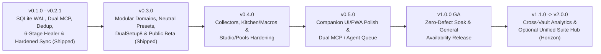

# Greenroom — Strategic Roadmap

> **Shipped Public Beta (`v0.3.0`):** `v0.2.1` $\rightarrow$ **`v0.3.0`** | **Next Minor Target:** `v0.4.0` | **Updated:** `2026-11-20` | **Lifecycle State:** `Active` ([`active.state`](active.state))

This roadmap tracks Greenroom's North Star goal, completed `v0.1.x`–`v0.3.0` milestones, upcoming `v0.4.0` $\rightarrow$ `v1.0.0 GA` $\rightarrow$ `v2.0.0` horizons, historical ledger, and parked Icebox ideas.

---

## 1. North Star Goal

Provide a fast, zero-cloud-dependency personal operations warehouse, desktop/mobile Companion PWA (`:8420` / `:8443`), and dual MCP agent bridge backed by a single self-healing SQLite WAL database (`data/greenroom.db`)—guaranteeing accurate cross-service game/media/book ownership, zero redundant disk re-hashing across local vaults, modular opt-in Kitchen and Creator Studio workflows, and `<0.5s` clean daemon lifecycle control.

---

## 2. Shipped Milestone (`v0.3.0` — Public Beta: Modular Domains, UI Modernization, `Foundation v0.5.2` & `DualSetup8`)

- **Completed Deliverables (`v0.3.0`):**
  - [x] **`GEN-01` — Modular Domain Profiles (`Catalog`, `Kitchen`, `Studio`):** Added [`domain_gates.py`](Dev/greenroom/core/domain_gates.py) and `data/config/settings.json` (`schemaVersion: 2`) to independently enable or disable **Catalog** (default ON on fresh installs), **Kitchen & Macro Planner**, and **Creator Studio & Agent Drops** across Companion navigation, REST routes (`{"status": "domain_disabled"}`), scheduler ticks, and stdio/Web MCP tools while preserving all SQLite rows. Existing populated databases auto-migrate with all three modules enabled.
  - [x] **`GEN-02` — Neutral Built-In Presets, Series Pools & Reviewer Aliases:** Extracted [`profiles_config.py`](Dev/greenroom/core/profiles_config.py) with four neutral macro presets (`Standard Daily`, `Active / Shift Worker`, `Fitness / Cut`, `Custom`), neutral `Default Pool` rotation rules, configurable `reviewerAliases`, `watchBufferMinHours`, and silent backward-compatible YAML/database migration shims.
  - [x] **`GEN-03` — UI Modernization, First-Run Setup Wizard, `Foundation v0.5.2` & `DualSetup8`:** Modernized the Companion UI onto Deep Slate Dark (plus Light `themeMode` and 3 density modes), persistent 26px Footer Status Bar, docked Live Execution Console (`Ctrl+\``), `Modules & Profiles` settings pill, and 2-step **First-Run Setup Wizard** (`onboarding.js`). Upgraded `Greenroom.Installer` to `Foundation v0.5.2` with dual **Online Setup** (TLS 1.2+ `.part` streaming + `Range` resume + `--offline-bundle`) and zero-network **Offline Setup** (`--no-index` + streamed pip progress + async `RunProcess`), 6-step install path precedence (`%LOCALAPPDATA%\Programs\Greenroom\` standalone default or optional umbrella `--suite-dir`), and Release automation fail-closed `ExitCode = 2`.
  - [x] **`GEN-04` — Dependency Alignment, Tier A 4-Folder Container & Public Repository Polish:** Aligned `Dev/requirements.txt` 1:1 with `Dev/pyproject.toml` (8 core packages + `setuptools`, `Dev/requirements-dev.txt`, optional `[media]` and `[google-workspace]` extras), retired legacy `Installers/` root packaging, added [`SECURITY.md`](SECURITY.md), [`CONTRIBUTING.md`](CONTRIBUTING.md), and `.github/` community health / CI / SignPath release / GitHub Pages workflows, and verified `104` Python + `11` .NET 8 tests.
- **Next Minor Target:** `v0.4.0` *(Collectors, Kitchen/Macros & Studio/Pools Hardening)*.

---

## 3. Upcoming Milestones (`v0.4.0` $\rightarrow$ `v1.0.0` $\rightarrow$ `v2.0.0`)

### `v0.4.0` — Collectors, Kitchen/Macros & Studio/Pools Hardening
- **Cornerstone Goal:** Deepen data reliability and domain ergonomics across all three generalized modules without breaking offline or unmounted-drive safety.
- **Planned Deliverables & Exit Criteria:**
  - [ ] **Data & Collector Hardening (`COL-01`):** Resolve remaining cross-service dedup edge cases and Redump/Plex/PriceCharting sync quirks; guarantee unmounted or offline drives never mark existing ROM or media rows as deleted.
  - [ ] **Kitchen, Pantry & Macro Enhancements (`KIT-01`):** Streamline barcode/drop ingestion, waste-tier alerts, and meal planning against custom `v0.3.0` macro profiles.
  - [ ] **Studio Radar & Dynamic Series Pools (`STU-01`):** Generalize channel buffer radar and multi-pool weighted selection beyond single-pool defaults.

### `v0.5.0` — Companion UI/PWA Polish & Dual MCP / Agent Queue
- **Cornerstone Goal:** Elevate desktop/mobile PWA usability and AI agent interoperability to release-candidate quality.
- **Planned Deliverables & Exit Criteria:**
  - [ ] **Companion UI & Mobile PWA Polish (`UI-01`):** Refine mobile/desktop responsiveness, zero orphaned CSS, `<0.5s` SSE shutdown, and reverse-proxy subpath parity across all `v0.3.0`/`v0.4.0` views.
  - [ ] **Dual MCP & Agent Drop Queue (`MCP-01`):** Improve stdio and Web HTTP/SSE MCP tool ergonomics, `agent_queue` drop reliability, and structured error/domain-gate responses.

### `v1.0.0` — General Availability & Production Soak Sign-Off
- **Cornerstone Goal:** Zero open P0–P2 audit findings, dual-installer checksum verification passing, and human-approved cutover of signed GA artifacts.
- **Planned Deliverables & Exit Criteria:**
  - [ ] Complete full multi-vault isolated-dir & production-mirror soak pass (`0` warnings, `0` orphan locks, `0` `ReadOnly` upgrade exceptions, `0` duplicate game regressions).
  - [ ] Receive explicit operator sign-off to promote `v1.0.0` GA, execute pre-cutover `.7z` backup + `--migrate-legacy` opt-in where needed, and verify live `/api/v1/health` `200 OK`.

### `v1.1.0` $\rightarrow$ `v2.0.0` — Cross-Vault Analytics & Unified Suite Experience
- **Cornerstone Goal (`v1.1.0`):** Deeper longitudinal collection valuation trends, automated backlog completion velocity metrics, and stream-to-VOD cut linking.
- **Destination Horizon (`v2.0.0`):** Seamless optional multi-app suite tab embedding inside an umbrella dashboard with low-latency cross-vault search.

---

## 4. Completed Milestones

| Version | Date | Headline Achievement | Reference |
| :--- | :---: | :--- | :--- |
| **`v0.3.0`** | `2026-11-20` | Public Beta launch: modular `Catalog`/`Kitchen`/`Studio` domain gates, neutral built-in presets, `settings.json` v2, Deep Slate Dark UI + Setup Wizard, `Foundation v0.5.2`, `DualSetup8` (`Online Setup` + `Offline Setup` + `Portable.zip`), pip bootstrap streaming, `104` Python + `11` .NET tests, and `.github/` public polish. | [`CHANGELOG.md`](CHANGELOG.md#030---2026-11-20) |
| **`v0.2.1`** | `2026-11-16` | Eliminated `--data-dir` / `--log-dir` drift under suite supervision, hardened `JobLock` contention/recovery, added `429 Retry-After` + `system_runs` failure auditing, unified dual `webhook_url` keys, and verified `92/92` isolated tests. | [`CHANGELOG.md`](CHANGELOG.md#021---2026-11-16) |
| **`v0.2.0-hf.1`** | `2026-11-15` | Synced `Foundation v0.4.1-hf.1`, standardized `APP_ISOLATED_TEST=1` + `--data-dir`, and retired legacy isolated-harness wrappers. | [`CHANGELOG.md`](CHANGELOG.md#020-hf1---2026-11-15) |
| **`v0.2.0`** | `2026-11-15` | `Foundation` SDK + `Foundation.Installer`, `<dataDir>\config\` clean-room overlays + `MPL-2.0`, `schema_indexes.sql` split, subpath reverse-proxy compatibility, Plex/Redump fixes, and `87` passing tests. | [`CHANGELOG.md`](CHANGELOG.md#020---2026-11-15) |
| **`v0.1.11`** | `2026-11-11` | Migration `014` cross-service game deduplication & multi-copy comparator, 6-stage `heal-db`, `Settings` pills (`useGlobalFormatRules`), Slide-Over Right Drawer, 8-tab mobile nav, and `<0.5s` pure-ASGI SSE shutdown (`82` tests). | [`CHANGELOG.md`](CHANGELOG.md#0111---2026-11-11) |
| **`v0.1.10`** | `2026-11-07` | Universal SemVer transition, Accounts & API Keys UI, Migration `013`, strict `user_rating` vs `critic_rating` / `audience_rating` split, and 5-column desktop KPI layout. | [`CHANGELOG.md`](CHANGELOG.md#0110---2026-11-07) |
| **`v0.1.0` – `v0.1.9`** | `2026-11-01` | 23-table SQLite WAL warehouse, 14 collectors, 6 processors, Companion PWA (`:8420`/`:8443`), Dataset Comparator, Redump/No-Intro DAT verifier, dual MCP servers, and Win32 Task Tray daemon. | [`CHANGELOG.md`](CHANGELOG.md) |

---

## 5. Icebox & Cutting-Room Floor

*Unscheduled stretch concepts intentionally parked outside active `0.x` scope to prevent feature creep:*
- **Automated OCR Receipt Line-Item Parser:** Local vision extraction for raw grocery photo drops in `drops/receipts/` (parked in favor of fast barcode + structured JSON/Markdown drops).
- **Cloud Multi-Node SQLite Replication:** Parked indefinitely; single-host SQLite WAL + Tailscale Serve HTTPS `:8443` + `.7z` atomic backups cover desktop and mobile workflows with zero sync conflicts.
- **Live PriceCharting Auto-Polling on Every Catalog Page Load:** Parked to protect external API rate limits; Greenroom uses the cached local price guide by default and reserves live API lookups for explicit Deal Scout queries.
